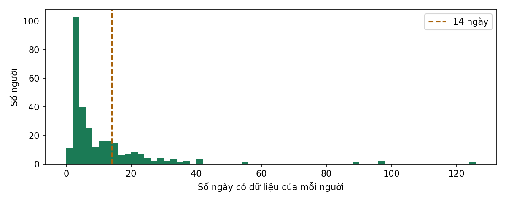
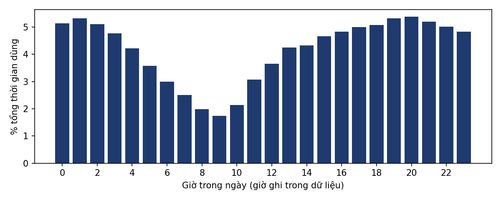
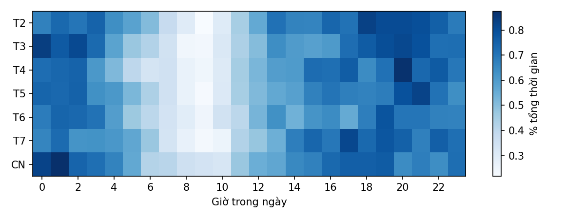

# EDA bộ dữ liệu LSApp

> Sinh tự động bởi `ml/eda/lsapp_eda.py`. Nguồn: https://github.com/aliannejadi/LSApp

## 1. Quy mô

| Chỉ số | Giá trị |
|---|---|
| Số dòng sự kiện | 3,658,589 |
| Loại sự kiện | Opened: 1,673,261, Closed: 1,667,014, User Interaction: 313,829, Broken: 4,485 |
| Số người | 292 |
| Số app | 87 |
| Khoảng thời gian toàn bộ | 2017-09-09 → 2018-05-17 |
| Số ngày có dữ liệu / người (trung vị; trung bình; max) | 5; 10.1; 126 |
| Từ sự kiện đầu đến cuối / người (trung vị; trung bình) | 4; 15.2 ngày |
| Người có ≥ 14 ngày dữ liệu | 69 |
| Người có ≥ 28 ngày dữ liệu | 20 |
| Phiên dùng app ghép được (Opened→Closed, ≤ 3 giờ) | 565,929 |
| Độ dài phiên (trung vị; trung bình) | 7 s; 49 s |

## 2. Phân bố theo giờ

- Tỷ lệ thời gian dùng trong khung khuya 22:00–06:00: **37.9%**.
- Giờ dùng nhiều nhất: 20h (5.4%); ít nhất: 9h (1.73%).

## 3. Tổng thời gian theo ngày

- Trung bình ngày thường: 157 phút; cuối tuần: 158 phút (chênh +1%).
- Tự tương quan chuỗi theo ngày (67 người ≥ 14 ngày, trung vị): trễ 1 ngày = 0.06, trễ 7 ngày = 0.04.

### Mô hình cơ sở (walk-forward, MAE theo phút)

| Mô hình | MAE (phút) |
|---|---|
| naive | 113.0 |
| seasonal_naive_7 | 119.2 |
| ma7 | 90.3 |

Số lượt dự đoán: 853 (từ ngày thứ 8 của mỗi người đủ điều kiện).

## 4. Top 10 app theo tổng giờ dùng

| App | Giờ |
|---|---|
| Google Chrome | 1,451 |
| Facebook | 1,003 |
| YouTube | 707 |
| Instagram | 397 |
| Facebook Messenger | 332 |
| Telegram | 282 |
| Twitter | 222 |
| Messages | 199 |
| Google | 186 |
| Reddit | 184 |
