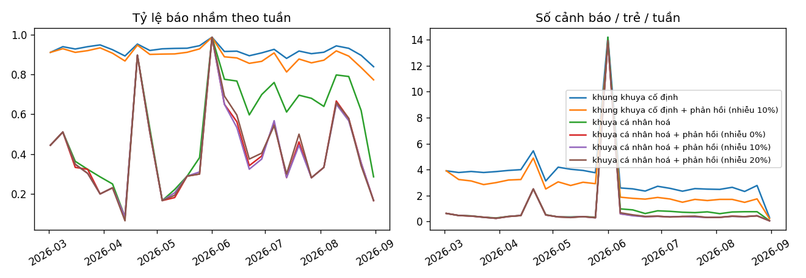

# Vòng phản hồi của phụ huynh (tuần 6)

Tầng 1 trên dữ liệu mô phỏng từ 02/03/2026; phụ huynh mô phỏng trả lời 70% số cảnh báo.

| chính sách                                 |   báo nhầm 4 tuần đầu |   báo nhầm 4 tuần cuối |   cảnh báo/trẻ/tuần (4 tuần cuối) |   recall cả giai đoạn |
|:-------------------------------------------|----------------------:|-----------------------:|----------------------------------:|----------------------:|
| khung khuya cố định                        |                 0.929 |                  0.919 |                             2.023 |                 0.828 |
| khung khuya cố định + phản hồi (nhiễu 10%) |                 0.917 |                  0.876 |                             1.296 |                 0.819 |
| khuya cá nhân hoá                          |                 0.42  |                  0.721 |                             0.585 |                 0.828 |
| khuya cá nhân hoá + phản hồi (nhiễu 0%)    |                 0.414 |                  0.511 |                             0.329 |                 0.819 |
| khuya cá nhân hoá + phản hồi (nhiễu 10%)   |                 0.414 |                  0.5   |                             0.322 |                 0.817 |
| khuya cá nhân hoá + phản hồi (nhiễu 20%)   |                 0.414 |                  0.504 |                             0.324 |                 0.817 |

Kích thước JSON mức thường ngày gửi xuống máy trẻ: trung vị 9.1 KB, lớn nhất 16.1 KB (100 trẻ).
