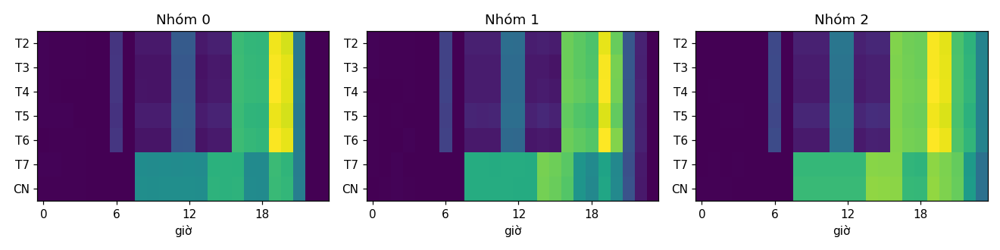

# M3 (nhóm thói quen) + M4 (gợi ý cho phụ huynh) — tuần 6

## M3 — K-Means trên 100 trẻ (năm học, trước 01/06/2026)

Chọn k = 3 theo silhouette (k=3: 0.24, k=4: 0.23, k=5: 0.19, k=6: 0.20). Độ khớp với nhóm tuổi (ARI) = 0.34.

|   nhóm |   số trẻ | mô tả                                    |   phút/ngày |   tỷ lệ khuya |   ngày nghỉ / ngày học | nhóm tuổi phổ biến   |
|-------:|---------:|:-----------------------------------------|------------:|--------------:|-----------------------:|:---------------------|
|      0 |       33 | hầu như không dùng khuya, ít mạng xã hội |         134 |         0.005 |                   1.42 | 6-10                 |
|      1 |       32 | hầu như không dùng khuya, dùng ít        |         143 |         0.012 |                   1.41 | 3-5                  |
|      2 |       35 | hay dùng khuya, nghiêng về mạng xã hội   |         402 |         0.11  |                   1.44 | 15-17                |

## M4 — gợi ý ngày 15/05/2026 (cửa sổ 28 ngày)

49/100 trẻ có ít nhất một gợi ý.

| luật          |   số trẻ |
|:--------------|---------:|
| giam_dan      |       20 |
| dat_gioi_han  |       18 |
| who           |       10 |
| gioi_han_game |        3 |

Ví dụ:

- `who`: Bé đang dùng khoảng 1 giờ 45 phút/ngày. WHO khuyến nghị trẻ 2–4 tuổi dùng màn hình không quá 1 giờ/ngày — có thể đặt giới hạn 1 giờ và giảm dần.
- `giam_dan`: Bé chạm giới hạn 3 giờ 45 phút ở 50% ngày đi học và xin thêm giờ khoảng 4 lần/tuần. Có thể nâng giới hạn ngày đi học lên 4 giờ rồi bật chế độ giảm dần về 3 giờ 45 phút trong 4 tuần, để bé ít phải xin thêm hơn.
- `dat_gioi_han`: Bé chưa có giới hạn thời gian. Có thể bắt đầu bằng mức hiện tại (7 giờ 45 phút ngày đi học) rồi giảm dần 10% mỗi tuần.
- `gioi_han_game`: Game chiếm 51% thời gian dùng máy. Có thể đặt giới hạn riêng cho game (ví dụ 2 giờ 15 phút/ngày đi học).
