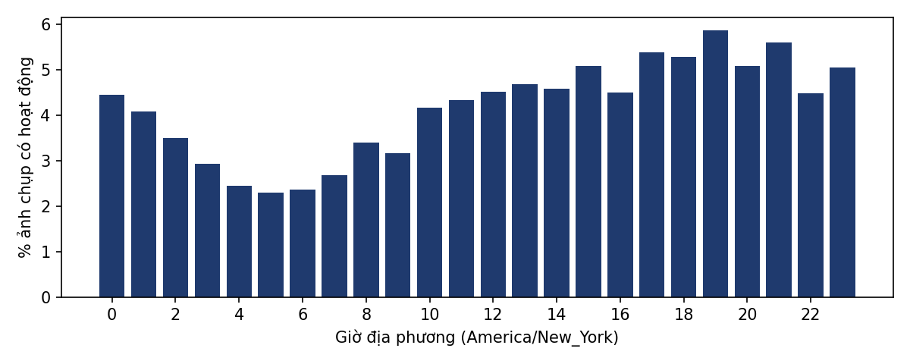
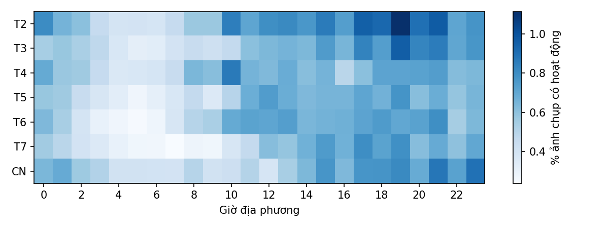
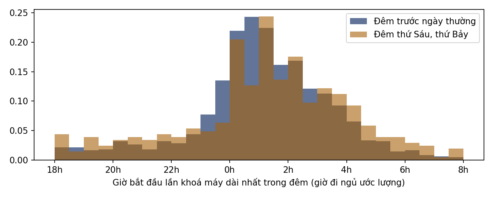

# EDA bộ dữ liệu StudentLife

> Sinh tự động bởi `ml/eda/studentlife_eda.py`. Nguồn: Zenodo record 3529253 (bản RDS của
> https://studentlife.cs.dartmouth.edu). Giờ địa phương: America/New_York.

## 1. Quy mô

| Chỉ số | Giá trị |
|---|---|
| Số sinh viên | 49 |
| Ảnh chụp danh sách app (mỗi 20 phút) | 200,767 |
| Khoảng thời gian | 2013-03-23 → 2014-01-16 |
| Ngày hợp lệ / người (≥ 50% ảnh chụp; trung vị; min; max) | 60; 22; 90 |
| Ảnh chụp bị loại (khoá máy dài, app nghiên cứu, launcher, hệ thống) | 84.8% |
| Lần khoá máy ≥ 60 phút | 9,275 |

## 2. Phân bố theo giờ địa phương

- Tỷ lệ ảnh chụp có hoạt động trong 22:00–06:00: **29.3%**.
- Giờ hoạt động nhiều nhất: 19h; ít nhất: 5h.

## 3. Chu kỳ tuần

- Chỉ số hoạt động trung bình (phút ước lượng/ngày): ngày thường 223, cuối tuần 207 (chênh -7%).
- Giờ đi ngủ ước lượng (trung vị): đêm trước ngày thường 01:48, đêm thứ Sáu/thứ Bảy 02:18 (2,014 đêm).
- Tự tương quan chuỗi theo ngày (trung vị): trễ 1 ngày = 0.20, trễ 7 ngày = 0.16.

### Mô hình cơ sở trên chỉ số hoạt động (walk-forward, MAE theo phút ước lượng)

| Mô hình | MAE |
|---|---|
| naive | 139.5 |
| seasonal_naive_7 | 150.1 |
| ma7 | 122.0 |

Số lượt dự đoán: 1,927.

## 4. Top 10 app trên cùng (trong các ảnh chụp có hoạt động)

| Package | Tỷ lệ |
|---|---|
| com.android.mms | 9.3% |
| com.google.android.gm | 8.4% |
| com.android.chrome | 7.2% |
| jp.gungho.padEN | 3.8% |
| com.android.settings | 2.9% |
| edu.dartmouth.cs.myruns3 | 2.8% |
| com.android.contacts | 2.7% |
| edu.dartmouth.cs.myruns4 | 2.6% |
| com.google.android.email | 2.6% |
| edu.dartmouth.cs.happiness | 2.4% |
